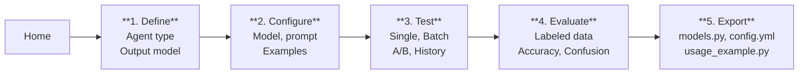

# Agent Builder UI

The Agent Builder is a Streamlit-based wizard for creating, testing,
evaluating, and exporting LLM agents without writing code. It guides
you through 5 steps and constructs agents in-memory, writing files
only when you explicitly Export.

## Installation and Launch

```bash
pip install agents7[ui]
agents7-ui
```

Custom host and port (useful for Docker or remote environments):

```bash
agents7-ui --host 0.0.0.0 --port 9000
```

Or from Python:

```python
from agents7.ui import launch
launch()                                  # defaults
launch(host="0.0.0.0", port=9000)        # custom
```

Requires Ollama running locally (`ollama serve`).

## Workflow Diagram



Agents are built in-memory during Test and Evaluate. No files are
written until Export.

## Step-by-Step Guide

### Step 1 -- Define

**Purpose:** Choose the agent type, give it a name, and define the
output model structure.

**Inputs:**

| Widget | Description |
|--------|-------------|
| Agent type | `classifier`, `detector`, `regressor`, or `labeler` |
| Agent name | Snake-case identifier (e.g. `sentiment_analyzer`) |

The rest of the form depends on the agent type:

- **Classifier:** Categories (name + description), Reasons
  (name + description), and a Category-to-Reason mapping
  (which reasons are valid for each category).
- **Detector / Regressor:** Value type (`float`, `int`, `str`, `bool`)
  and Reasons (name + description).
- **Labeler:** Arbitrary output fields, each with a name, type,
  optional flag, and description.

**Outputs stored in `state_dict`:**

```
agent_type, agent_name,
categories, reasons, category_reasons   (classifier)
value_type, reasons                     (detector / regressor)
fields                                  (labeler)
```

A live preview of the generated Pydantic model code is shown at the
bottom of the page.

---

### Step 2 -- Configure

**Purpose:** Select the LLM model, write the system prompt, and
provide input/output examples.

**Inputs:**

| Widget | Description |
|--------|-------------|
| Model selector | Dropdown of models detected from Ollama |
| System prompt | Free-text prompt that instructs the LLM |
| Examples | List of input/output pairs (resizable) |

**Outputs stored in `state_dict`:**

```
model_name, system_prompt, examples
```

Two previews are available:

- **YAML config preview** -- the `config.yml` that will be exported.
- **Resolved prompt preview** -- the full prompt the LLM will see,
  built by constructing the in-memory agent.

---

### Step 3 -- Test

**Purpose:** Run the agent against inputs and iterate on the prompt.

This step has four tabs:

#### Single Input

Enter plain text or a JSON dict. The agent runs immediately and
displays the parsed output model and LLM metrics (tokens, duration).
Each result is appended to the test history.

#### Batch Test

Provide multiple inputs at once via:

- A text area (one input per line, or a JSON array)
- A JSONL file upload (one JSON object per line)

After upload, a preview of the first 5 records is shown. The agent
processes every input sequentially with a progress bar.

#### A/B Compare

Compare two prompt versions side-by-side:

1. Save prompt versions using the **Version Management** panel
   (captures the current system prompt, examples, and model name).
2. Select Version A and Version B.
3. Provide test inputs (same formats as Batch Test).
4. The runner builds two agents and processes every input through both,
   reporting: total inputs, matching outputs, agreement percentage,
   and per-input details.

Requires at least 2 saved prompt versions.

#### History

A reverse-chronological list of all single/batch test results from
the current session (input, output, metrics).

---

### Step 4 -- Evaluate

**Purpose:** Measure the agent's accuracy against labeled data.

**Data sources** (pick one):

| Source | Format |
|--------|--------|
| Upload CSV | Columns: `input`, then one column per expected output field |
| Upload JSONL | One JSON object per line with `input` + expected fields |
| Inline editor | Grid of text inputs with the same column layout |

Expected fields are determined by the agent type:

| Agent type | Expected fields |
|------------|----------------|
| Classifier | `category`, `reason` |
| Detector / Regressor | `reason` |
| Labeler | All field names defined in Step 1 |

**Evaluation run:**

The agent processes every row. For each row, actual output fields are
extracted from the response model and compared to the expected values
(case-insensitive string comparison; enum values use `.name`).

**Results display:**

- **Overall metrics:** Total, passed, failed, accuracy.
- **Per-field accuracy:** One accuracy metric per expected field.
- **Confusion matrix** (classifier only): Category-level confusion.
- **Per-case details:** Expandable rows with input, expected, actual,
  and error information.
- **Downloads:** CSV and JSONL result files.

---

### Step 5 -- Export

**Purpose:** Save all generated artifacts to disk.

Files are written to `workspace/<agent_name>/`:

| File | Contents |
|------|----------|
| `models.py` | Output model source code (enums + Pydantic class) |
| `config.yml` | YAML agent configuration |
| `usage_example.py` | Quick-start script showing single and batch usage |
| `eval_data.csv` | Copy of the evaluation dataset (if provided) |
| `eval_results.csv` | Evaluation results in CSV (if evaluation was run) |
| `eval_results.jsonl` | Evaluation results in JSONL (if evaluation was run) |

## Agent Types Reference

| Type | Base class | Output model base | Output fields | Use case |
|------|------------|-------------------|---------------|----------|
| Classifier | `Classifier` | `ClassificationProperty` | `category: StrEnum`, `reason: StrEnum` | Categorize inputs into discrete classes |
| Detector | `Detector` | `Property[bool]` | `value: bool`, `reason: StrEnum` | Detect presence/absence of a property |
| Regressor | `Regressor` | `Property[T]` | `value: T`, `reason: StrEnum` | Extract a numeric or typed value |
| Labeler | `Labeler` | `BaseModel` | User-defined fields | General-purpose structured extraction |

All agent types inherit from `Labeler`. Detector and Regressor share
the same `Property[T]` base, differing only in the value type
(bool vs float/int/str/bool).

### Generated model examples

**Classifier:**

```python
from enum import StrEnum
from agents7.models import ClassificationProperty

class SentimentCategory(StrEnum):
    POSITIVE = "Positive sentiment."
    NEGATIVE = "Negative sentiment."

class SentimentReason(StrEnum):
    ENTHUSIASTIC = "Expresses enthusiasm."
    FRUSTRATED = "Expresses frustration."

class SentimentAnalyzer(ClassificationProperty):
    category: SentimentCategory
    reason: SentimentReason

    CATEGORY_REASONS = {
        SentimentCategory.POSITIVE: [SentimentReason.ENTHUSIASTIC],
        SentimentCategory.NEGATIVE: [SentimentReason.FRUSTRATED],
    }
```

**Detector / Regressor:**

```python
from enum import StrEnum
from agents7.models import Property

class TemperatureReason(StrEnum):
    COLD = "Below 15C."
    HOT = "Above 25C."

class TemperatureDetector(Property[float]):
    reason: TemperatureReason
```

**Labeler:**

```python
from pydantic import BaseModel

class PersonExtractor(BaseModel):
    name: str
    age: int | None = None
    city: str
```

## Data Flow

### Session state

The UI stores all persistent data in five `st.session_state` keys,
initialized once when the app loads:

| Key | Type | Purpose |
|-----|------|---------|
| `step` | `int` | Current page index (0 = Home, 1-5 = steps) |
| `state_dict` | `dict` | Flat dictionary with all agent configuration |
| `test_history` | `list[dict]` | Single/batch test results from Step 3 |
| `eval_results` | `list[EvalResult] \| None` | Evaluation results from Step 4 |
| `prompt_versions` | `list[PromptVersion]` | Saved prompt snapshots for A/B comparison |

### state_dict lifecycle

`state_dict` is a flat dictionary that accumulates user choices as
they move through the steps:

```
Step 1 sets:  agent_type, agent_name, categories, reasons,
              category_reasons, value_type, fields
Step 2 sets:  model_name, system_prompt, examples
Step 4 sets:  eval_data
```

Each page reads `state_dict` from session state, mutates it in place,
and the changes are immediately available to all subsequent pages.

### state_dict to AgentBuilderState

Backend modules (codegen, evaluation, helpers) never touch session
state directly. Instead, pages convert `state_dict` into an
`AgentBuilderState` dataclass via the `_state_from_dict()` helper in
`_pages/__init__.py`. This dataclass provides computed properties
like `model_class_name`, `category_enum_name`, and
`reason_enum_name`.

### In-memory agent construction

`build_agent_from_state()` in `helpers.py` converts the state into
a live agent:

1. Look up the agent class (`Classifier`, `Detector`, `Regressor`,
   or `Labeler`) from the `agent_type` string.
2. Call `create_model_class(state)` to dynamically build a Pydantic
   model class with StrEnum fields.
3. Create an `LLMEngine` pointing to the selected Ollama model.
4. Instantiate the agent with the prompt, examples, and model.

The returned agent is fully functional and disposable -- a new one
is built each time the user clicks Test or Evaluate.

## File Formats

### JSONL input (Batch Test and Evaluation)

One JSON object per line. Each object should be a dict:

```jsonl
{"text": "I love this product!"}
{"text": "Terrible experience.", "context": "support chat"}
```

Non-dict JSON values are automatically wrapped as `{"text": <value>}`.
Plain text lines (not valid JSON) are also wrapped as
`{"text": "<line>"}`.

### CSV input (Evaluation)

Standard CSV with headers. First column is `input`, remaining columns
are expected output fields:

```csv
input,category,reason
"I love this!",POSITIVE,ENTHUSIASTIC
"Terrible.",NEGATIVE,FRUSTRATED
```

### Exported files

**models.py** -- Python source code defining the output model with
StrEnum classes and the Pydantic model class.

**config.yml** -- YAML configuration compatible with `from_yaml()`:

```yaml
name: sentiment_analyzer
version: 1
engine:
  provider: ollama
  model: qwen3
system_prompt: |
  Analyze the sentiment of the input text.
output_model: models.SentimentAnalyzer
system_examples:
- input: I love this!
  output: '{"category": "POSITIVE", "reason": "ENTHUSIASTIC"}'
```

**usage_example.py** -- Runnable script demonstrating single and
batch agent usage with the exported model and config.

**eval_results.csv** -- One row per evaluated input:

```csv
input,category_expected,category_actual,category_passed,reason_expected,reason_actual,reason_passed,passed,error
"I love this!",POSITIVE,POSITIVE,True,ENTHUSIASTIC,ENTHUSIASTIC,True,True,
```

**eval_results.jsonl** -- One JSON object per evaluated input:

```json
{"input": {"text": "I love this!"}, "expected": {"category": "POSITIVE"}, "actual": {"category": "POSITIVE"}, "field_results": {"category": true}, "passed": true, "error": null}
```
